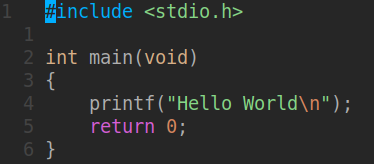
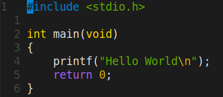
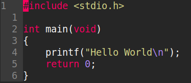

# VimConfig

## Introduction

Simple Vim configuration script to get started right the way!

The configurations include:
- Support relative numbering
- Exclude selected file extensions from filename completion
- Set tabs as 4 space characters
- Ignore case during searches
- Highlight searched words
- New colorschemes
- New keymaps

This solution is targeted for beginners in both Vim and Linux that want to have a basic starting point without going deep into configurations.
Jump into action!

## Donations

I believe in **free and open source software**! Help the OSS community by donating below:

[](https://www.paypal.com/donate/?hosted_button_id=AMFZ83MA4Z3RA)

## Instructions

### Installing Vim

Vi IMproved (Vim) editor is usually available by default in most Unix systems. In case Vim is not installed by default, use the following command:
 
- Debian-based (Debian, Ubuntu, Linux Mint, Pop OS)
```shell
sudo apt install vim
```

- Arch-based (Arch, Manjaro, EndeavourOS, Garuda Linux)
```shell
sudo pacman -S vim
```

- Fedora-based (Fedora, Nobara, Ultramarine)
```shell
sudo dnf install vim
```

### Configuring Vim

Download and extract this repository, or clone it with Git, then open a terminal in its root folder. With Vim installed, run setup as your normal user, without `sudo`.

Setup installs `~/.vimrc`, `~/.vim/autoload/onedark.vim`, and the two bundled files in `~/.vim/colors/`. Existing files that differ are backed up under `~/.vimconfig-backup.XXXXXX` (the exact directory is printed) before replacement. Unrelated files are preserved. Symlinked destinations are refused; manage those manually.

```shell
./setup.sh
```

Vim is now configured. Setup can also be invoked by its path from another directory, and running it again updates the same files without nesting directories. Identical files are left alone.

To restore a backup, close Vim and copy `.vimrc` from the printed backup directory to `~/.vimrc`, and any backed-up `autoload/` or `colors/` files to the corresponding paths under `~/.vim/`. Backups contain only files replaced by that run; files newly installed by setup must be removed manually if you want to undo them. Setup stops on errors, but does not automatically roll back a partial installation.

## Features Overview

### Colorschemes

Two colorschemes are bundled, with a custom Onedark variant:

- Onedark
- Onedark Custom
- Monokai

Onedark Custom is the default. Edit `~/.vimrc` to switch themes, keeping exactly one `colorscheme` command active. For stock Onedark, comment out the entire `let g:onedark_color_overrides` block, including its closing `\}` line, and keep `colorscheme onedark`. For Monokai, comment out `colorscheme onedark` and uncomment `colorscheme monokai`. Restart Vim after changing themes. Samples with C code, in the order above:

 
 
 

### Keymaps

The following shortcuts are available:

- Ctrl + C -> Esc in insert mode
- Ctrl + / -> Comment line
- Ctrl + Shift + / -> Uncomment line
- `\c` -> Comment line
- `\u` -> Uncomment line

The backslash shortcuts use Vim's default leader key and also work on visual selections. Ctrl+/ and Ctrl+Shift+/ depend on your terminal and may not be distinguishable; use the leader shortcuts if they do not work.

Commenting supports C, C++, Java, Scala, shell, Ruby, Python, conf, fstab, TeX, mail, and Vim filetypes. Other filetypes are left unchanged.

## Notes

- Windows is not supported!
- Tested on Manjaro and Ubuntu (24.04)
- Shoutout to:
    - [brandon-wallace](https://github.com/brandon-wallace/vimrc)
    - [joshdick](https://github.com/joshdick/onedark.vim)
    - [ku1ik](https://github.com/ku1ik/vim-monokai)

